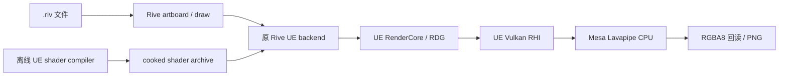

# Rive UE RHI/RDG 轻量原型

## 整套工具的统一 CLI 包

当前整合入口为 [统一命令行工具包](prototype/cli-toolkit.md)：一个包包含 Rive、原生 UMG、VerseVM 和 Widget Blueprint/UMG 动画编辑工具，通过 `rive-tool` 的 JSON 命令操作。`start/status/stop` 管理轻量后台协调服务，原生 worker 按操作启动；资产和任务记录保存在显式工作区。构建整套工具使用 `--all-tools`，默认构建仍只选择 Rive。

下面 preview.3 的体积是此前分别发布的组件包，不能当作整合包的实际体积；整合包的去重体积和运行验收单独记录。

最新打包轮次见 [preview.3](https://github.com/cc8887/Rive-UE-Lite/releases/tag/v0.1.0-preview.3)：Linux 的 Rive、UMG、Verse 和 Widget Blueprint 动画编辑 worker 分包交付，Windows 为 Rive-only。macOS 已复用已有 Zig 交叉编译出真实 Rive arm64 对象，但缺少 Metal SDK，完整 UE 程序仍未构建成功；不将源码或对象文件作为可运行的 Mac 包。

从已生成的 `package-manifest.json` 输出发布归档可使用 `scripts/prepare_release.py --tag <新标签> --package <平台> <功能> <包目录>`；随后在 Linux 运行 `scripts/verify_release_linux.py --release-dir artifacts/release/<标签>`，Windows 使用 `scripts/verify_windows_package.py` 验证实际解压包。归档绑定源码提交和每个文件的 SHA-256，运行验收单独记录。

源码、工具和交付物均放在此独立目录，Linux 构建另用专属缓存。`engine/` 固定为 UE6 `62d7c1a7125b52b10ee1b714838f515f3563f795`；`vendor/rive-unreal/` 固定为 `8461a2dc90924aeadc1f7eed99e6ae2de1b490f0`，原生 runtime 固定为 `47d1cd54ccefd468db7cb26ecc4699ae1723dd85`。不修改原引擎、Rive 仓库或现有工程。

## Windows Rive-only 已验证

Windows x64 已使用原型目录内的 MSVC 14.50.35731 构建，保留 UE Vulkan RHI/RDG 路径。两份独立原生 UE cooker archive 的静态、动画和状态机共五组截图对照均为 RGBA 零差异。实际 ZIP 解压后隐藏开发 engine/vendor，三次运行及包内启动脚本均通过。

Windows ZIP 为 23.46 MiB，解压后 59.97 MiB；RTX 5080 上三次独立进程首图 0.88–1.94 秒，峰值 working set 387.34–388.12 MiB。单源文件重编译 15.39 秒，无改动构建 3.81 秒，均使用已有依赖和构建缓存。默认仍不编译或打包 Engine/Renderer/UMG/Slate 和可选 Verse 模块；Windows Core 自带的外部 libpas 分配器保留。Windows 无 GPU、UMG 和 Verse 包尚未验证。

入口为 `scripts/build_windows.ps1`；详见 [Windows 构建说明](prototype/windows.md)、[实测报告](prototype/windows-validation.json) 和 [当前 Release](https://github.com/cc8887/Rive-UE-Lite/releases/tag/v0.1.0-preview.2)。

## macOS 适配与交叉编译尝试

已增加 Mac 的 MetalRHI 选择、Engine/Slate 依赖隔离补丁、arm64/x64 原生库选择，以及构建、独立 shader cook、打包和截图对照脚本。默认仍只构建 `RiveRhiLite`；开发 cooker/reference 须显式调用。**当前尚未在 Mac 上编译或运行成功**，WSL 实际尝试受 Mac SDK/目标头文件缺失阻塞，不能据此发布 macOS 二进制。Linux 默认包已重新构建，并在隐藏 GPU 和开发目录后与原生 UE 截图零差异。

入口：`bash scripts/build_ui.sh --platform=macos --arch=arm64`。环境准备、验证步骤和未验证边界见 [macOS 构建说明](prototype/macos.md)。

## 可选 UMG 已实现与实测

同一个 `RiveRhiLite.uproject` 提供两个独立缓存的渲染构建目标：默认 `RiveRhiLite`，显式 `--with-umg` 选择 `RiveUmgHost`；可选 VerseVM worker 见下文。原始 UE/Rive 工程的 HEAD 与工作区 diff 哈希均未变化。Linux 构建入口（私有 mount namespace 需要 root，实际 UBT 以 uid 1000 运行）：

```sh
sudo bash scripts/build_ui.sh
sudo bash scripts/build_ui.sh --with-umg
```

| 本轮真实交付 / 构建测量 | 默认 Rive | 开启 UMG |
| --- | ---: | ---: |
| 原始部署文件，含清单 | 51.08 MiB | 186.11 MiB |
| 实际 tar.gz | 16.74 MiB | 70.86 MiB |
| 去除调试信息后的 ELF | 29.85 MiB | 162.35 MiB |
| 单 Main.cpp 重新编译 + 完整链接，入口总耗时 | 51.32 秒 | 177.11 秒 |
| 其中 UBT 耗时 | 48.33 秒 | 171.99 秒 |

编译数据来自本机 Ryzen 9950X / WSL2、Linux Development 单体构建、依赖缓存已存在、最多 12 个并行动作。通过只更新时间戳使一个 Main.cpp 失效，实际均执行一次 Compile、一次 Link 和 metadata，随后恢复原时间戳，源码字节不变。Link 包含正常符号导出和 strip；这是单次观察，首次冷构建没有独立成功计时。系统 CPU Vulkan ICD、LLVM 和系统库另计，包中不含 SDK、调试文件或 Designer。

增强版的最小界面使用真实 UCanvasPanel、UBorder、UButton、UNativeWidgetHost，以及保留 Rive 原 RHI/RDG 算法的 Slate 自定义绘制。`package/ui-umg-02` 已在隐藏 `/dev/dxg`、`/dev/dri`、开发 engine/vendor 后实际出图并正常退出。原生 UE Engine Program 参考端使用原生 Rive adapter；两端独立 cook 生成不同路径、不同 SHA 的完整 Rive/utility/Slate archive，各 11,520 个排列，其中 Slate 为 43 类型、51 排列。

最终 12 次进程 / 6 对全图 RGBA 和 alpha 全部零差异，无掩码或容差，播放 metadata 相同，无运行 error/ensure。覆盖 Bounce 0 / 0.75 秒、隐藏 Rive 控制、bankcard 羽化、Rocket 状态机 idle / pressed；动画、状态机和隐藏 Rive 都确实改变画面。每端每例使用自己的新 Mesa 缓存，CPU affinity 与 Mesa 线程均为 2。增强宿主峰值 RSS 350.31–379.30 MiB，完整首图 3.35–4.22 秒（六个单次样例，含隐藏控制；不是连续帧率）。这是选定的无 World UMG Program 路径，不是 Editor 视口、任意 Widget Blueprint 或 UI 材质验收。

默认路径的实际 100 份编译/共享响应文件、21 模块链接输入、3 模块 UHT 清单和部署包均排除 UMG、Slate、Engine、Renderer 等重依赖。默认不调用原生 Engine cooker、UMG 参考端或字体下载。开启后再关闭开关的构建为 up to date / 0 actions。Lite 的 `-Capabilities` 返回 `umg=false`，`-Ui=umg` 明确返回退出码 9；增强版同时支持 `-Ui=umg` 和 `-Ui=rive`，后者也已与原生 Rive 图逐像素对照通过。包标志与 receipt 不匹配会被拒绝。

UE6 非 constinit 配置使用引擎原有 lazy CDO API 完成真实类/属性注册，再按需构造 CDO/config，消除了首轮 SlateSettings 尚未链接的 ensure；未修改引擎核心、默认资产或错误门槛。Linux 指标工具 18 项单测通过。

- [完整使用、构建、cook、打包与复现命令](Source/RiveUmgHost/README.md)
- [验收与测量汇总](artifacts/umg-optional/summary.json)、[6 对截图及进程/内存/时间](artifacts/umg-optional/matrix-01/summary.json)
- [UMG 实际截图](artifacts/umg-optional/matrix-01/bankcard/host/output.png)、[原生 UE 参考图](artifacts/umg-optional/matrix-01/bankcard/reference/output.png)
- [默认依赖排除审计](artifacts/umg-optional/lite-exclusion-final.json)、[命令与打包负例](artifacts/umg-optional/cli-guards.json)
- [Rive 包体](artifacts/umg-optional/package-rive-01/report.json)、[UMG 包体](artifacts/umg-optional/package-umg-02/report.json)
- [Rive 实际增量构建](artifacts/umg-optional/incremental-rive-01/report.json)、[UMG 实际增量构建](artifacts/umg-optional/incremental-umg-01/report.json)

## UMG 源蓝图最小闭环

新建、读取和修改源 Widget Blueprint 使用 `python scripts/widget_bp.py`，包括 `create/read/import/patch/preview/export`；Windows 自动调用 WSL Ubuntu 原生 worker。`read` 直接加载已有 `.uasset`，`patch` 修改现有控件并原生编译保存，保留未编辑控件及已有图表；不是只重建 JSON 样例。创建支持自定义 CanvasPanel/Border/Button/TextBlock 布局。编辑依赖通过 `bash scripts/build_ui.sh --with-widget-blueprint` 显式构建，默认 Rive 不包含它。完整用法和范围见 [Widget Blueprint 工具入口](prototype/widget-blueprint-authoring.md)。

原生 UMG 动画入口为 `animation list/create/patch`，并可用 `preview --animation Intro --time 0.5` 或播放控制脚本进行 CPU Vulkan 预览；支持 opacity、平移、缩放、旋转的常量/线性关键帧，保留未修改轨道。实现范围、native 求值路径及包体/启动对照见 [UMG 动画](prototype/umg-animation.md)。动画依赖仍位于可选编辑 worker 中。

独立 `RiveUmgBlueprintWorker` 已完成真实未 cook `.uasset` 的加载、原生布局出图、文案/位置/尺寸修改、原生蓝图编译保存、两次新进程重载。9 个进程全部正常退出，无运行 error/ensure；修改前后与独立设置属性的原生 UE WidgetTree 预览参照均为全图 RGBA 零差异，重载复现也为零差异。修改确实改变 16,887 个像素，嵌套 Border 子控件按 UE 布局规则跟随父级变化。

隐藏 GPU 设备并使用 llvmpipe、CPU affinity/Mesa 线程均为 2 时，生成类预览首张完整 PNG 为 12.82–13.45 秒，峰值 RSS 701.58–717.21 MiB；修改编译保存并正常退出为 4.53 秒。编辑 worker ELF 为 568.68 MiB，此数值不含部署依赖闭包；编辑后的源蓝图 23,268 字节，下载 ZIP 5,339 字节。这是选定的原生控件静态 WBP、640×400/DPI 1 的离屏验证，不是完整 Editor 视口或任意项目依赖验收。

编辑 worker 明确链接 UMGEditor/UnrealEd，须单独构建；默认 Rive 和 `--with-umg` 运行宿主的选择入口不变。当前源蓝图样例使用 CanvasPanel/Border/TextBlock，已有 Rive RHI/RDG 路径保留在原目标中。

- [构建与服务端操作流程](Source/RiveUmgBlueprintWorker/README.md)
- [完整闭环与测量记录](artifacts/umg-blueprint/roundtrip-03/summary.json)
- [修改后的可下载蓝图](artifacts/umg-blueprint/roundtrip-03/WBP_RoundTrip-edited.zip)
- [修改前](artifacts/umg-blueprint/roundtrip-03/04-load-original/output.png)、[修改后](artifacts/umg-blueprint/roundtrip-03/07-reload-edited/output.png)、[原生参照](artifacts/umg-blueprint/roundtrip-03/08-native-edited/output.png)

## 可选 VerseVM：真实执行与 UI 出图

默认仍只构建 Rive；`sudo bash scripts/build_ui.sh --with-verse` 增加独立的 `RiveVerseWorker`（无 Engine/Renderer/UMG，新 VerseVM + AutoRTFM）。已跑通同份 Verse 控制器 → 真实字节码 → UI 命令 → 现有 Rive UE RHI/RDG → 无 GPU Linux 截图。事件、Await 恢复、race 取消/defer/迟到事件、失败回滚以及 3 组故障注入通过；按下/空闲与原生 UE 独立 shader cook 的两组截图 RGBA 零差异。

合计部署包 **98.70 MiB / tar.gz 34.96 MiB**，比原 Rive 包增加 **47.62 MiB / 压缩约 18.21 MiB**。两核独立进程的 worker 就绪中位数 **2.926 秒**，编译/加载阶段 **355.8 毫秒**，整条链路首图 **4.764 秒**。worker 单 C++ 文件直接缓存 target 的实际增量编译/链接 **60.67 秒**，完整构建入口含准备校验 **124.11 秒**。不是冷构建或冷整机启动基准。

**同进程二次代码加载实验触发原生包导入断言，未通过，交付采用每次修改重启 worker。** 共享控制器尚未回到真实 UEFN 对照；本地适配器也没有实现 Fortnite 玩家/设备/UI 原生 API。默认构建排除 worker、VerseCompiler/VerseNative/Solaris/libpas 和 UMG，Rive/UMG 两个既有渲染二进制 SHA 未变化。详见 [实现、测试范围、全部指标与复现](prototype/verse-vm.md)、[机器汇总](artifacts/verse-vm/summary.json) 和 [部署包](package/verse-ui-02/verse-ui.sh)。

此前仅测前端的 **2.40 MiB** 增量不是完整 VM 成本；历史数据保留在 [接入前评估](prototype/verse-assessment.md)。

## 独立 shader、动画与状态机实测

本轮已将真实 `LinearAnimationInstance` / `StateMachineInstance` 播放驱动接入两个宿主。时间线按固定步长从零重放，在事件的实际时刻应用输入并结算；每张图保存实际驱动选择、调用次数、输入值和状态变化。覆盖 Bounce 动画、bool Hover/Press、number 转换、重复 trigger 和 pointer 开关五个确定性样例。

最终 `playback-independent-02` 已通过：双方各自实际 cook，分别加载不同路径、不同 SHA 的 archive，在隐藏 `/dev/dxg`、`/dev/dri` 的 namespace 中以 uid 1000 使用 llvmpipe CPU Vulkan 渲染。60 次进程均正常退出，30 对完整 RGBA/alpha 截图零差异，无掩码或容差；实际播放 metadata 也完全一致。16 项必需画面变化和 12 项每端同刻输入效果检查均通过。

| 对照范围 | 截图对数 | 结果 |
| --- | ---: | --- |
| 原五组静态 fixture | 5 | 全部 RGBA/alpha 零差异 |
| 动画、bool/number/trigger/pointer 状态机关键帧 | 19 | 全部 RGBA/alpha 与播放记录一致 |
| 同一时刻无输入控制 | 6 | 两端一致，且输入确实改变画面和状态 |

原生 `WITH_ENGINE=1 / WITH_EDITOR=1` 工具实际调用 Engine 的 `BeginCompileShader → GlobalBeginCompileShader → FShaderCompilingManager → SaveGlobalShaderFile`，正常退出后生成 7,082,186-byte archive，11,469 个排列全部成功。轻量工具独立生成 17,147,055-byte archive，11,468 个排列全部成功，其中 9,889 次命中自己的 job cache、1,579 次实际调用 DXC。两边的 Rive `(type, permutation)` 域精确同为 11,360 个；原生侧多一个 utility 排列。两次执行、工具、输出、日志及编译缓存独立，Mesa 缓存也按宿主分开。

独立 cook 首轮发现了共用 archive 会掩盖的真实问题：轻量编译器使用 DXC 却漏声明 `COMPILER_DXC=1`，使 Rive 羽化填充的正反面覆盖率分支反转。首轮 29/30 对通过，bankcard 有 72,399 个不同像素。只补这一编译环境声明、重新 cook 后，bankcard 聚焦复测归零，完整 60 次新进程对照也全部通过。未修改 Rive shader、draw/flush 算法、两个运行宿主或原生 archive；旧工具、源码和失败证据均保留。

- [播放协议与驱动边界](Source/RivePlayback/README.md)、[五个可复现时间线](fixtures/playback/scenarios.json)
- [最终简洁报告](artifacts/playback-independent-02/review-summary.json)、[完整验收](artifacts/playback-independent-02/summary.json)、[60 张原图并排画廊](artifacts/playback-independent-02/gallery.html)、[原图与链接审计](artifacts/playback-independent-02/gallery-audit.json)
- [轻量侧独立 cook](artifacts/shaders-independent-lite-02/provenance.json)、[原生侧独立 cook](artifacts/shaders-canonical/full-01/provenance/provenance.json)、[实际复现命令](scripts/measure_playback_README.md)
- [首轮失败结果](artifacts/playback-independent-01/review-summary.json)、[羽化源码与素材依据](artifacts/playback/diagnostics/bankcard-feather-cause-01.json)、[单一宏修正的受控运行验证](artifacts/playback/diagnostics/bankcard-dxc-runtime-03.json)
- [12 次真实进程负例](artifacts/playback/rejections-01/summary.json)、[错误原因审计](artifacts/playback/rejections-01/message-audit.json)
- [当前轻量链接排除审计](artifacts/playback/lite-linkage-01.json)：实际 21 个模块，无 Engine/Renderer
- [原生编译核心源码审计](artifacts/playback/canonical-core-source-audit-01.json)：8 个 Engine 编译环境、View metadata 和 archive 序列化关键文件与固定 UE commit 一致；双方共用的 preprocessor 修复单列
- [播放、adapter 与工程隔离审计](artifacts/playback/final-source-audit-02.json)：14 项检查通过，保留两端原始 draw/flush/pass/shader 路径，原仓既有修改未变化
- [修正后的部署包与字节实测](artifacts/playback/package-02/report.json)、[压缩包](artifacts/playback/package-02/deploy-package.tar.gz)
- [隐藏 engine、vendor、GPU 后的包内验证](artifacts/portable/playback-03/summary.json)、[包体与便携验证复现命令](artifacts/playback/package-02/commands.json)

修正后的 `package/playback-02` 包含五个播放样例、时间线及 bankcard，应用文件共 53,561,592 bytes（51.08 MiB），实际 gzip 包 17,547,658 bytes（16.73 MiB），ELF 31,296,864 bytes（29.85 MiB）。本轮未重新采集正式性能数据；下面的 RSS 和出图时间属于第一轮静态包。

包内 bankcard 和 Bounce 0.75 秒均在隐藏 engine/vendor/GPU 的 namespace 中通过实际启动器出图并正常退出：bankcard 与本轮原生 UE 参考图、Bounce 与已验证关键帧均 RGBA/alpha 零差异。包内容运行前后哈希相同。gzip SHA256 为 `ae6fc93ca0fd6c37ace80bbb0ebb52703d9972dece2d783054fe17a50c1b0f3e`。

一致性结论限于这些固定样例的 UE Program 离屏 `FRenderTarget` / RHI / RDG 路径。此处旧报告不覆盖 UMG/Slate 合成，新的最小 UMG 对照见文首。Editor 视口、硬件 GPU 对照、GPU Canvas/Ore、脚本或整个 Rive 库仍未验收；关键帧是每次从零重放后的截图，不是连续渲染帧率测试。

```sh
bash package/playback-02/render.sh package/playback-02/fixtures/ball_test.riv /tmp/bounce.png \
  -Scenario="$PWD/package/playback-02/fixtures/playback/bounce_animation.json" \
  -PlaybackMetadata=/tmp/bounce-playback.json
```

## 同项目按需启用 UMG 的构建方案

已按方案保留同一个 `.uproject` 和共享源码，用外部构建开关选择两个独立缓存的 Target；默认只构建 Rive，增强产物在运行参数中选择 Rive 或 UMG。当前单体 Lite 程序无法在运行中临时加载未编入的 UMG，`WITH_ENGINE` 也改变 UObject 接口，不能混用不同构建底座的插件。

[可选 UMG 方案与源码依据](prototype/optional-umg-design.md) 记录了模块边界、默认工具与资源排除、shader 初始化、缓存和按需 worker 方案。构建开关与最小 UMG 宿主已实现；实现和测量入口见 [UMG 宿主说明](Source/RiveUmgHost/README.md)。

## 接入前的原生 UMG 容量与编译成本历史评估

以下为接入前的历史二进制、构建日志、原生源码和容量样本评估；本轮真实 UMG 交付与验收见文首。现有 Reference 已实际链接 UMG、SlateRHIRenderer、MovieScene 等 156 个模块，并在最终符号表保留 `UWidget::TakeWidget`、`UUserWidget::Initialize` 和 `FWidgetRenderer::DrawWindow`；它提供了接入所需重依赖的实测容量锚点。普通非 Server UMG 依赖 Engine/Renderer，不能继续套用轻量目标的模块排除结论。

| 相同资源基础的容量样本 | 轻量程序 | Engine/UMG 依赖参考程序 |
| --- | ---: | ---: |
| 已剥离调试信息的 ELF | 29.85 MiB | 161.34 MiB |
| 原始文件 | 51.07 MiB | 182.81 MiB |
| 实际 gzip，level 9 | 16.69 MiB | 65.73 MiB |

容量样本排除旧启动器/包清单，以明确不把它当可运行 UMG 包；它保留同一组 Rive 资源，并在参考侧加入实际 receipt 中已存在的 Renderer 数据。参考 receipt 尚有一个未落盘的 libsndfile 文件。原生 Slate 默认字体/图片等另有 799 文件、7.66 MiB 的 pinned GitDependencies 真实 payload 元数据，尚未下载；因此原始容量锚点约为 190.47 MiB，再加 Slate shaders、实际 UI 材质及项目资产。对于少量资源、无 Designer 的极简原生 UMG Runtime，先按 **190–220 MiB 原始、70–90 MiB 压缩**规划；这是预算范围，不是新 UMG 程序实测值，系统依赖另计。

同轮历史的单个 Main.cpp 增量构建，轻量程序为 52.41 秒，参考程序为 229.27 秒，均为编译、Link 和 metadata 三个动作。参考侧约 30 秒 C++ 编译、178 秒完整 Link 动作；后者包括 ld、dump_syms、Breakpad 编码和 objcopy，不能全算纯链接。另一次参考增量为 162.81 秒。当前可将此类单文件 C++ 修改按约 3–4 分钟理解，而非每次重编全部引擎；头文件/UHT/全局宏变化成本另算，完整成功的冷全编尚无单独计时。

云端布局迭代宜固定预编译宿主，以 `.riv` 或宿主支持的布局数据创建原生 widget，避免每次布局调整触发 C++ 重链。Widget Blueprint 内容修改走蓝图编译/烘焙；运行已烘焙 Blueprint 不要求 UMGEditor，服务端直接编译源 Blueprint/运行 Designer 则需要另一组 Editor 依赖。源码已确认 `-NoDumpSyms` 可跳过 Breakpad 符号生成并保留 strip，但优化后的耗时尚未实测。无 World/Play 的基础 UWidget/Slate/FWidgetRenderer 路径有源码依据；UI 材质和 DPI/指针等访问 GEngine 的路径仍需分项验证。

- [评估汇总与预算边界](artifacts/umg-assessment/summary.json)
- [容量样本实测](artifacts/umg-assessment/capacity-02/report.json)、[实际 ELF/符号/构建计时审计](artifacts/umg-assessment/cost-audit.json)
- [UMG 依赖与能力分层](artifacts/umg-assessment/dependency-audit.md)、[默认 Slate 内容元数据](artifacts/umg-assessment/slate-content-metadata.json)
- 容量复现：`python scripts/assess_umg_capacity.py --output-dir artifacts/umg-assessment/capacity-03`，每次用新目录；不触发 C++ 构建。

## 第一轮静态包的历史性能基线

最小原型已在 Ubuntu 24.04 / WSL2、Mesa 25.2.8 llvmpipe CPU Vulkan 上跑通。运行进程所在的私有 namespace 内 `/dev/dxg`、`/dev/dri` 均不可见；独立部署测试还隐藏开发用的 engine/vendor，从 `/tmp` 调用包内 `render.sh`，成功输出真实 Rive PNG 并正常退出。

以下是第一轮旧 shader archive 对应的 Linux x64 Development 实测，未做 Shipping/LTO 优化。它使用修正前的羽化分支；本轮没有重新采集正式 RSS/出图性能，不能将这些数值或 60 次正确性验证的过程时间当作新版包性能。

| 包体项目 | 实测 |
| --- | ---: |
| 轻量 ELF，已剥离调试符号 | 29.80 MiB |
| 保留 Engine/Renderer 的参考 ELF | 161.32 MiB |
| 完整应用包，含 shader、配置、备用 Vulkan loader 和卡片 fixture | 51.02 MiB |
| 实际压缩包 `.tar.gz` | 16.71 MiB |

对内嵌文字、渐变的 `bankcard.riv`，采样默认 artboard 的静态初始帧，输出 512×512 PNG：

| 指标 | 默认 32 逻辑 CPU 可用 | 限制 2 逻辑 CPU，LP_NUM_THREADS=2 |
| --- | ---: | ---: |
| 首轮完整 PNG 墙钟时间 | 1.080 s | 1.161 s |
| 后两轮重复启动中位数 | 1.174 s | 0.907 s |
| 三轮峰值 RSS 的最大值 | 309.39 MiB | 269.25 MiB |

每轮均为新进程。每组首轮使用全新 Mesa shader 磁盘缓存，后两轮复用该组缓存；未清空 OS 页缓存，也不将结果标为进程内暖机帧耗时。两逻辑 CPU 通过 affinity 限制，仍是同一台 Ryzen 9 9950X / WSL2 主机，并非独立双核云服务器。

第一轮五个静态初态与包含真实 Engine/Renderer 和原插件 `FRenderTarget` 包装的 UE Program 对照，RGBA/alpha 均零差异，但两边共用旧 inline SPIR-V archive，因此未暴露后来独立 cook 发现的羽化问题。当前视觉结论以上面的独立对照为准。`clip_tests` 初态全透明，`circle_clips` 提供可见裁剪覆盖。

交付与证据：

- [全部验收与实测汇总](artifacts/measurements/summary.json)
- [已测量的部署压缩包](artifacts/measurements/default-02/lite/deploy-package.tar.gz)
- [默认配置测量报告](artifacts/measurements/default-02/lite/report.json)、[双逻辑 CPU 测量报告](artifacts/measurements/cpu2-01/lite/report.json)
- [五组逐像素比较](artifacts/captures/integration-02/comparison-five-fixtures.json)、[实际运行与像素内容](artifacts/captures/integration-02/reference-captures.json)
- [隐藏源码/GPU 后执行包内启动脚本的日志](artifacts/setup/portable-final-launcher.log)
- [当前源码 pins 与原仓状态](artifacts/source-state.json)、[引擎 patches 验证](prototype/patches/all-patches-validation.json)

应用包依赖服务器已安装的软件 Vulkan ICD 和系统库。系统 loader、Lavapipe 及其闭包与应用 `DT_NEEDED` 合并去重为 199,481,112 bytes（190.24 MiB）；加应用包为 241.26 MiB 的已识别文件，未计入整个基础操作系统。包内备用 loader 已计入应用包，不重复计算。外部库均已解析，`standalone_bundle=false` 表示它们使用服务器安装的系统库。详细清单见 [依赖审计](artifacts/measurements/runtime-dependency-audit.json) 和测量报告的 `runtime_dependency_inventory`。

## 原型组成

- `RiveRhiLite`：Program target，`bCompileAgainstEngine=false`，直接 RHI 创建纹理，原 Rive UE backend 向 RDG 提交 pass，RGBA8 回读并输出 PNG。
- `RiveLiteRenderer`：从现有 Rive 插件抽取 2D adapter。保留原 `flush()`、RDG pass 实现及 shader；删除 UObject/UMG、Engine 纹理包装。首轮不支持 Ore、GPU Canvas、脚本。
- `RiveLiteShaderCompiler`：构建阶段的离线编译工具，调用 UE VulkanShaderFormat，输出目标 Linux 的 cooked global shader archive。运行包不携带编译器。
- `RiveUeReference`：保留真实 Engine/Renderer 模块及原插件的 `FRenderTarget` 包装，作为离屏 UE Program 对照；可指定独立 shader archive 和共享播放协议。它不覆盖编辑器视口或 UMG 合成。细节见 [参考程序说明](Source/RiveUeReference/README.md)。
- `RiveUeShaderCooker`：独立构建的 `WITH_ENGINE=1`、`WITH_EDITOR=1` Program，使用原生 Engine shader 编译入口、环境和序列化，为 Rive 及所需 utility shaders 生成 Linux archive。它不进入轻量部署包。细节见 [原生编译路径与隔离修改](Source/RiveUeShaderCooker/README.md)。
- `RivePlayback`：两端共享的原生动画/状态机驱动，记录实际对象、输入、时间推进及状态证据。
- `RiveLiteRhiProbe`：验证宿主启动、Vulkan、纹理清屏及回读的中间目标；其图片不能用作 Rive 验证。
- `prototype/patches/`：可重放的 VulkanRHI 隔离 patch 和源码检查证据。
- `scripts/measure_ue_lite.py`：实际运行、部署包大小、RSS、出图时间及截图比较。详见 `scripts/measure_README.md`。

## 验证标准

只有以下证据都齐全，才能确认本次目标完成：

1. 实际 Linux ELF 和 link response/map 不包含 `Engine`、`Renderer` 模块。
2. 进程无法访问 GPU 设备节点，并实际选中 CPU Vulkan。
3. 用相同 fixture、runtime、shader 源码、尺寸、时间和像素/alpha 设置产生 Rive PNG；独立 cook 对照还要求两端各自实际生成 archive，覆盖相同 Rive permutation 域。
4. 与原生 UE 参考 PNG 做像素比较；静态源码相同不能代替截图。
5. 基于实际部署包记录压缩前后字节，分别记录宿主驱动依赖；测峰值 RSS、首图和重复出图时间。

各项真实状态写入 `artifacts/`。缺失项必须标为 incomplete，不能用估算值填补。



轻量运行时保留 Core、CoreUObject、ApplicationCore、RHI、RHICore、RenderCore 和 VulkanRHI。这里的裁剪目标是 `Engine`、`Renderer` 模块；CPU 出图仍通过真实 Vulkan 驱动执行。第一轮截图采样默认 artboard 的静态 `Seconds=0`，尚未选择动画或状态机实例，不能把 `-Seconds` 当成动画播放验证。

## 构建与运行

依赖、SDK 和生成物不纳入源码交付。准备时应保留精确版本和下载/生成记录；此目录当前已在 Windows + WSL Ubuntu 中准备隔离环境。下面是依赖和生成物已准备完成后的构建片段，不是一键安装脚本。

```sh
# WSL / Linux；构建系统本身需要 .NET10 和该提交指定的 UE v26 工具链。
bash scripts/build_linux.sh ubt --source "$PWD/dependencies/nuget-feed" -p:NuGetAudit=false
bash Source/RiveLiteRenderer/build_native_linux.sh
bash scripts/build_linux.sh RiveLiteRhiProbe
bash scripts/build_linux.sh RiveLiteShaderCompiler
bash scripts/build_linux.sh RiveRhiLite
```

离线 shader 编译参数见 `Source/RiveLiteShaderCompiler/README.md`。已生成的独立部署包可直接使用：

```sh
bash package/final-01/render.sh \
  package/final-01/fixtures/input.riv /absolute/path/output.png \
  -Width=512 -Height=512 -Seconds=0
```

在已安装 Mesa/Lavapipe 的 Linux 服务器解压实测包后：

```sh
tar -xzf deploy-package.tar.gz
bash final-01/render.sh final-01/fixtures/input.riv /tmp/rive.png
```

运行 RHI probe 时增加 `-ProbeRHI`，它不需要 `.riv` 或 shader archive。它只测图形启动，不证明 Rive 已运行。

`scripts/measure_no_gpu.sh` 可在私有 mount namespace 隐藏 `/dev/dxg`、`/dev/dri`，再降回普通用户运行测量；不会改变 WSL 全局 `/dev`。同时设置 `VK_ICD_FILENAMES` 和 `VK_DRIVER_FILES` 指向 Lavapipe ICD。已保存的 CPU Vulkan 前置证据不等于 UE/Rive 验证通过。

像素使用 `PF_R8G8B8A8`、无 sRGB texture flag、`RCM_UNorm`、禁止回读 gamma 转换。参考图必须采用相同约定。

部署时用 `scripts/package_linux.py` 从真实 `.target` receipt 打包，并显式加入 archive 与 fixture；SDK、源码、离线编译器、调试符号不进入包体。包内包含 UE 随附的备用 Vulkan loader；系统优先加载的 loader、Lavapipe ICD 及其系统库闭包另外统计。`render.sh` 自动选择已安装的 Lavapipe ICD，也可用 `RIVE_LITE_ICD=/absolute/path/lvp.json` 指定。

包内 shader archive 位于 `shaders/global.bin`；运行时的空 shader 映射目录统一使用 `Engine/Shaders`，避免 Windows 上 `shaders` 与 `Shaders` 的大小写合并。无需携带 shader 源码。

`scripts/check_portable_linux.sh` 会在私有 namespace 隐藏开发用的 engine/vendor、隐藏 GPU 节点、降回普通用户，从 `/tmp` 调用包内的 `render.sh`，以检查源码树回退依赖。`scripts/measure_pair.py` 负责同输入的参考截图和实际测量；每轮必须使用新证据目录。
